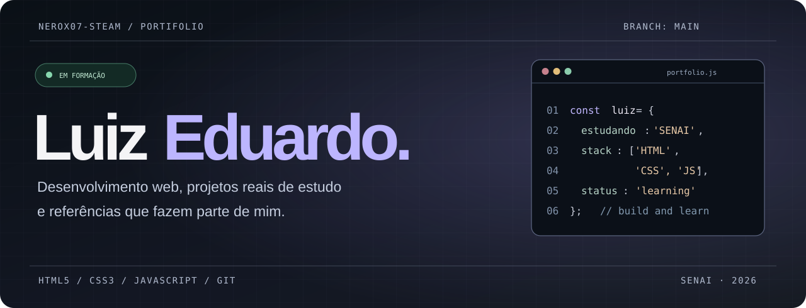

<div align="center">



# Luiz Eduardo · Portfólio

**Estudante de Desenvolvimento de Sistemas no SENAI | HTML • CSS • JavaScript**

Uma vitrine dos projetos que estou criando enquanto aprendo desenvolvimento web.

[](https://portifolio-projetos-git-main-pedro-luiz.vercel.app/)
[](https://xqrens-portifolio.vercel.app/)
[](./docs/PROJETOS.md)


</div>

---

## ✦ Sobre este repositório

Meu nome é **Luiz Eduardo**. Estudo programação no **SENAI** e uso este repositório para compartilhar meus trabalhos, acompanhar minha evolução e aprender a organizar projetos no GitHub.

O portfólio principal é um site estático criado com **HTML, CSS e JavaScript**, com interface escura, navegação direta e algumas imagens de anime que já faziam parte da minha coleção de referências.

A ideia é simples: mostrar **quem sou, meus projetos, o Mente em Flor e como entrar em contato comigo**, sem inventar experiência profissional que ainda não tenho.

### O que você encontra no site

| Seção | Conteúdo |
| --- | --- |
| **Sobre mim** | Minha apresentação, estudos no SENAI e tecnologias que estou aprendendo |
| **Projetos** | Dois destaques e os **19 exercícios reais** guardados neste repositório |
| **Julya ♡** | Uma seção pessoal dedicada à minha namorada |
| **Mente em Flor** | Apresentação e link para meu site educativo sobre saúde mental |
| **Contato** | GitHub, Instagram e canal para sugestões |

Os exercícios têm **busca pelo nome, filtros HTML/CSS/Páginas e uma opção para expandir a lista completa**. Não é necessário instalar bibliotecas nem criar uma conta.

## 🚀 Projetos em destaque

<table>
  <tr>
    <td width="50%" valign="top">
      <h3>01 · Portfólio pessoal</h3>
      <p>Meu espaço na web. Interface responsiva, referências visuais de anime e cards para explorar os trabalhos do SENAI.</p>
      <p><b>HTML • CSS • JavaScript</b></p>
      <p><a href="https://portifolio-projetos-git-main-pedro-luiz.vercel.app/">Visitar site ↗</a> · <a href="./projetos/">Ver código ↗</a></p>
    </td>
    <td width="50%" valign="top">
      <h3>02 · Mente em Flor</h3>
      <p>Projeto educativo sobre saúde mental: conteúdo de acolhimento, pausas, reflexões e caminhos para buscar ajuda.</p>
      <p><b>HTML • CSS • JavaScript</b></p>
      <p><a href="https://xqrens-portifolio.vercel.app/">Visitar site ↗</a> · <a href="./mente-em-flor/">Ver código ↗</a></p>
    </td>
  </tr>
</table>

> **Importante:** o Mente em Flor é educativo. Não oferece diagnóstico nem substitui apoio profissional. O portfólio e o Mente em Flor são **dois projetos diferentes da Vercel**, embora o código esteja no mesmo repositório.

### Trabalhos do SENAI

São **19 exercícios** de várias fases dos meus estudos, incluindo currículo, álbum, semáforo, receita, páginas de perfil, seletores CSS e outros.

**[→ Acessar a lista completa dos 19 exercícios](./docs/PROJETOS.md)**

## 🧰 Tecnologias

| Ferramenta | Aplicação |
| --- | --- |
| **HTML5** | Estrutura de páginas, conteúdo semântico e links |
| **CSS3** | Layout, responsividade, tipografia e apresentação |
| **JavaScript** | Navegação em celular, busca e filtros dos projetos |
| **Git & GitHub** | Histórico de mudanças e organização do código |
| **Vercel** | Hospedagem dos dois sites |

Também estudo um pouco de **Python** e **banco de dados**, mas o foco deste repositório é a web.

## 🗂️ Estrutura do repositório

```text
Portifolio/
├── assets/
│   └── portfolio-banner.svg        # Banner do README
│
├── projetos/
│   ├── index.html                  # Site principal
│   ├── style.css                   # Estilos e responsividade
│   ├── script.js                   # Interações e filtros
│   ├── Img/                        # Fotos e referências visuais
│   ├── projeto_album/
│   ├── projeto_botao/
│   ├── projeto_curriculo/
│   └── ...                         # Demais exercícios e avaliações
│
├── mente-em-flor/
│   ├── index.html                  # Site de saúde mental
│   ├── style.css
│   ├── script.js
│   └── novidades.js
│
├── docs/
│   ├── PROJETOS.md                 # Catálogo com 19 trabalhos
│   └── DIVULGACAO.md               # Apresentações para compartilhar
│
├── CONTRIBUTING.md                 # Sugestões e bugs
└── README.md
```

## 💻 Rodar localmente

Você pode abrir os arquivos pelo **Live Server** do VS Code ou iniciar um servidor local usando Python 3:

```bash
git clone https://github.com/NeroX07-steam/Portifolio.git
cd Portifolio
python -m http.server 8000
```

Depois acesse:

- **Portfólio:** http://localhost:8000/projetos/
- **Mente em Flor:** http://localhost:8000/mente-em-flor/

Os dois projetos usam caminhos relativos, então execute o servidor a partir da raiz clonada.

## 🎨 Visual e referências

Escolhi uma estética escura e minimalista, inspirada em interfaces de editores de código e na atmosfera de obras como *Serial Experiments Lain* e *Neon Genesis Evangelion*. As imagens de anime utilizadas já estavam no diretório `projetos/Img/`.

São **referências visuais de terceiros**, não artes criadas por mim nem material sob uma licença declarada neste repositório. Direitos das obras e imagens pertencem aos respectivos autores e titulares.

## 💬 Feedback

Se encontrar um erro de responsividade, um link quebrado ou tiver uma sugestão de melhoria, pode [abrir uma issue](https://github.com/NeroX07-steam/Portifolio/issues/new/choose). Há modelos para bugs e ideias de melhoria.

Consulte o [guia de contribuições](./CONTRIBUTING.md).

## 📫 Contatos

- **GitHub:** [@NeroX07-steam](https://github.com/NeroX07-steam)
- **Instagram:** [@lxqrens](https://www.instagram.com/lxqrens/)
- **Portfólio:** [portifolio-projetos-git-main-pedro-luiz.vercel.app](https://portifolio-projetos-git-main-pedro-luiz.vercel.app/)
- **Mente em Flor:** [xqrens-portifolio.vercel.app](https://xqrens-portifolio.vercel.app/)

---

<div align="center">

<sub>Feito por Luiz Eduardo · 2026</sub>

**Aprendendo, criando e melhorando um projeto de cada vez.**

</div>
