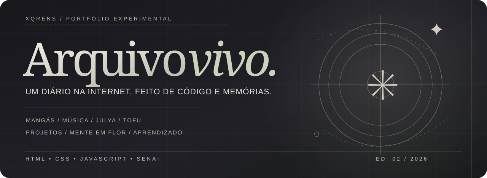

<div align="center">



<br>

# XQRENS · ARQUIVO VIVO

### Um portfólio que parece um diário, lê como um mangá e cresce junto comigo.

Sou **Luiz Eduardo**, estudante de **Desenvolvimento de Sistemas no SENAI**. Crio sites para aprender HTML, CSS, JavaScript e descobrir como uma interface pode ter personalidade.

[](https://portifolio-projetos-git-main-pedro-luiz.vercel.app/)
[](https://xqrens-portifolio.vercel.app/)
[](./docs/PROJETOS.md)


**[Visitar site](https://portifolio-projetos-git-main-pedro-luiz.vercel.app/) · [Explorar os projetos](./docs/PROJETOS.md) · [Documentação da edição](./docs/ARQUIVO-VIVO.md) · [Enviar feedback](./CONTRIBUTING.md)**

</div>

---

## ✦ O que é este projeto, em dez segundos?

Um **portfólio pessoal feito com HTML, CSS e JavaScript**, com estética editorial inspirada nos mangás que gosto. Ele reúne páginas do meu aprendizado, experiências interativas, música, pessoas importantes da minha vida e um projeto separado de conscientização sobre saúde mental.

Não é uma plataforma comercial. Não estou tentando parecer um desenvolvedor experiente. Quero mostrar **o que aprendi, o que errei e o que ainda quero construir**.

> **Dois sites diferentes:** o [portfólio original](https://portifolio-projetos-git-main-pedro-luiz.vercel.app/) apresenta meus trabalhos. O [Mente em Flor](https://xqrens-portifolio.vercel.app/) é o projeto educativo de saúde mental. Os dois têm código neste repositório.

## ☾ ED. 02 / O que tem de novo?

| Capítulo | Experiência | O que funciona |
| :--- | :--- | :--- |
| **01 · Modo Mangá** | Ler o portfólio por capítulos | Índice lateral, modo leitura, anterior/próximo e atalhos no teclado |
| **02 · Julya.exe** | Quatro pequenas cartas para minha namorada | Botões alternam os textos sem recarregar |
| **03 · Tofu World** | Meu e da Julya: nosso filho Tofu | Brincadeiras, respostas e contador de carinhos virtual |
| **04 · Sala de Música** | Músicas e atmosferas | Destaque editável no navegador e links de descoberta no Spotify |
| **05 · Laboratório SENAI** | Estudos de HTML, CSS e JavaScript | Comparações didáticas e links para exercícios verdadeiros |
| **06 · Mangateca 2.0** | Acervo de **22 obras** | Busca, temas, lista de desejos, estados de leitura, favoritos e sorteio |
| **07 · Evolução GitHub** | Marcos do aprendizado | Quatro etapas ligadas a arquivos e histórico reais |
| **08 · Segredos** | Fragmentos escondidos | Três fragmentos, mensagem desbloqueável e um código no teclado |

Esses recursos **complementam** o portfólio que já existia, com as seções Sobre, Julya, Tofu, projetos, SENAI, mangás, Mente em Flor e contato. A grade dos **19 exercícios** agora também tem **busca sem acentos, filtros por tipo de atividade e contador de resultados visíveis**.

<details>
<summary><b>✳ Interações extras, para quem gosta de explorar</b></summary>

- Pesquisar títulos por nome e filtrar por **psicológico, drama, arte ou fantasia**.
- Pesquisar os **19 projetos** pelo nome e filtrar por estrutura, estilos CSS e páginas.
- Marcar uma obra como **descobrir, quero ler, lendo ou já tenho**, e alternar favoritos.
- Sortear uma sugestão da estante visível.
- Trocar entre **papel, noite e ameixa**.
- Explorar os capítulos com o modo leitura usando as setas **← →**, ou pelos controles na tela.
- Ler cartas interativas, brincar com o Tofu e guardar fragmentos secretos.
- Acessar a navegação rápida do site original com **Ctrl + K**.
- Exportar ou apagar uma anotação do diário original.
- Usar o site no celular, respeitando a opção do dispositivo por movimento reduzido.

</details>

## 🧩 Projetos em destaque

<table>
<tr>
  <td width="50%" valign="top">
    <h3>01 / XQRENS — Portfólio</h3>
    Um diário interativo em forma de site: capítulos, mangás, animações e pequenos experimentos.
    <br><br>
    <a href="./projetos/index.html">Código do portfólio ↗</a> ·
    <a href="https://portifolio-projetos-git-main-pedro-luiz.vercel.app/">Abrir site ↗</a>
  </td>
  <td width="50%" valign="top">
    <h3>02 / Mente em Flor</h3>
    Um espaço educativo com pausas, propostas de autocuidado, cartas e informações de apoio.
    <br><br>
    <a href="./mente-em-flor/index.html">Código do Mente em Flor ↗</a> ·
    <a href="https://xqrens-portifolio.vercel.app/">Abrir site ↗</a>
  </td>
</tr>
<tr>
  <td valign="top">
    <h3>03 / Meus estudos no SENAI</h3>
    Exercícios de estrutura HTML, CSS, páginas, semáforo, currículo e outros trabalhos de aula.
    <br><br>
    <a href="./docs/PROJETOS.md">Explorar os 19 exercícios ↗</a>
  </td>
  <td valign="top">
    <h3>04 / Arquivo Vivo</h3>
    O módulo da edição 02, feito em arquivos separados para não bagunçar a base do site.
    <br><br>
    <a href="./projetos/arquivo-vivo.js">JavaScript ↗</a> ·
    <a href="./projetos/arquivo-vivo.css">CSS ↗</a>
  </td>
</tr>
</table>

## 🛠️ O que estou aprendendo

| Tecnologia | Uso no repositório |
| --- | --- |
| **HTML5** | Estrutura semântica, conteúdo, botões, links e formulários |
| **CSS3** | Layout responsivo, modo noturno, tipografia e animações |
| **JavaScript** | Eventos, filtros, controles de leitura e interatividade |
| **localStorage** | Guardar preferências neste navegador, sem conta |
| **Git / GitHub** | Commits, histórico, organização e colaboração |
| **Vercel** | Publicação dos projetos estáticos |
| **Python e banco de dados** | Outros assuntos que estudo, ainda não são o foco deste site |

O foco desta edição foi **progressive enhancement**: se um extra falhar, o conteúdo HTML principal continua disponível. Não há bibliotecas obrigatórias para os módulos novos nem um serviço externo de autenticação.

## 🗂️ Organização dos arquivos

```text
Portifolio/
├── assets/
│   └── arquivo-vivo-banner.svg   # Capa original deste README
│
├── projetos/
│   ├── index.html                # Portfólio e capítulos
│   ├── style.css                 # Estilos anteriores, preservados
│   ├── script.js                 # Interações anteriores
│   ├── motion.js                 # Animações editoriais
│   ├── arquivo-vivo.css          # Estilos da edição 02
│   ├── arquivo-vivo.js           # Interações da edição 02
│   ├── Img/                      # Imagens já usadas no portfólio
│   └── projeto_*/                # Trabalhos e exercícios antigos
│
├── mente-em-flor/
│   ├── index.html
│   ├── style.css
│   ├── script.js
│   └── novidades.js
│
├── docs/
│   ├── ARQUIVO-VIVO.md           # Manual da nova edição
│   ├── PROJETOS.md               # Acervo dos exercícios
│   └── DIVULGACAO.md             # Textos para apresentar e pedir feedback
├── CONTRIBUTING.md               # Como sugerir melhorias
└── README.md
```

## ▶️ Executar localmente

Você não precisa instalar React ou outras dependências para explorar este código.

1. Faça o clone e entre na pasta:

```bash
git clone https://github.com/NeroX07-steam/Portifolio.git
cd Portifolio
```

2. Com Python 3 instalado, inicie um servidor local:

```bash
python -m http.server 8000
```

3. Abra no navegador:

| Site | Endereço local |
| --- | --- |
| Portfólio | http://localhost:8000/projetos/ |
| Mente em Flor | http://localhost:8000/mente-em-flor/ |

Também dá para abrir `projetos/index.html` pelo *Live Server* do VS Code.

> **Hospedagem:** o portfólio principal e o Mente em Flor são **projetos Vercel diferentes**. Um commit no GitHub nem sempre aparece imediatamente nos dois endereços; confira a versão publicada antes de compartilhar.

## ♡ Privacidade, conteúdo e limites

- **Mangateca, carinhos do Tofu e destaque musical:** salvos em `localStorage`, apenas no navegador onde foram editados. Não são sincronizados com outros visitantes nem com meu site publicado.
- **Spotify:** o site não lê a música que estou ouvindo ao vivo. Existem links para meu perfil e para pesquisas públicas; uma integração real precisaria de autorização.
- **Referências a animes e mangás:** são comentários e nomes de obras, não uma reprodução de capítulos ou páginas protegidas.
- **Mente em Flor:** projeto educativo, não faz diagnóstico nem substitui ajuda profissional. Em situação de risco imediato, procure apoio presencial e os serviços de emergência.
- **Código e imagens:** este repositório ainda não declara uma licença aberta. Não presuma autorização para republicar imagens pessoais ou reutilizar código sem pedir permissão.

## ✉️ Contribuições e feedback

Sou estudante e recebo bem observações específicas: bugs, sugestões de acessibilidade, ajustes de responsividade e organização do código. Não precisa pedir desculpa por apontar algo que não funciona, é assim que eu descubro o que melhorar.

**[Abrir uma issue](https://github.com/NeroX07-steam/Portifolio/issues/new/choose)** · [Ler como contribuir](./CONTRIBUTING.md) · [Explorar o catálogo](./docs/PROJETOS.md)

## 🌱 Próximas melhorias

- [x] Índice e modo leitura em capítulos
- [x] Busca dos 19 projetos, filtros de tema e contador de resultados
- [x] Mangateca com busca, filtros e lista de leitura local
- [x] Cartas para Julya, Tofu World e Sala de Música
- [x] Comparações didáticas no Laboratório SENAI
- [x] Linha do tempo com links para o código
- [x] Segredos, navegação e cuidado com movimento reduzido
- [ ] Fazer testes visuais em vários navegadores e tamanhos de tela
- [ ] Adicionar imagens de obras com autorização dos detentores dos direitos, quando possível
- [ ] Configurar uma integração oficial do Spotify, caso faça sentido
- [ ] Melhorar o desempenho e documentar testes de acessibilidade

## 🌐 Contato

[GitHub](https://github.com/NeroX07-steam) · [Instagram](https://www.instagram.com/lxqrens/) · [Portfólio](https://portifolio-projetos-git-main-pedro-luiz.vercel.app/) · [Mente em Flor](https://xqrens-portifolio.vercel.app/)

---

<div align="center">

### Uma página de cada vez.

*Feito para aprender, lembrar e continuar criando.* ♡

<sub>© 2026 · Luiz Eduardo · XQRENS / ARQUIVO VIVO</sub>

</div>
